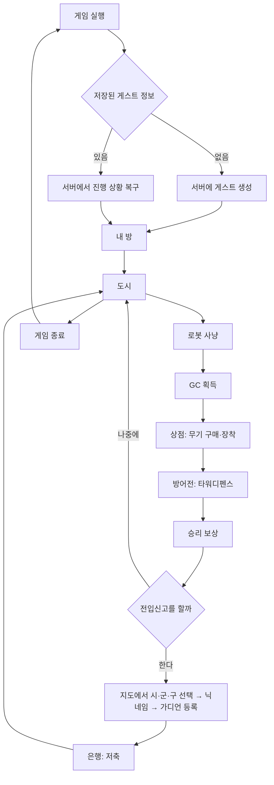

# USER_FLOW — 사용자 흐름

> 기준 v6.0 · 2026-11-13 · 상태: 설계 (미구현)

## 1. 원칙

- 첫 플레이에서 메뉴 화면을 띄우지 않습니다. 실행하면 바로 방입니다.
- 목표 표시는 한 번에 하나입니다. 빛나는 대상과 바닥 화살표로 알려 줍니다.
- 글 대신 몸으로 익힙니다. 키 안내는 필요한 순간에 한 개만 보여 줍니다.
- 선택을 강요하지 않습니다. 전입신고, 은행, 투자는 권유를 닫아도 놀이가 이어집니다.

## 2. 전체 흐름

## 3. 첫 플레이 (지시서 4장 9단계)

| # | 단계 | 플레이어가 보는 것 | 조작 | 화면 UI | 서버 |
|---|---|---|---|---|---|
| 1 | 게임 실행 | 로고 후 바로 방 | 없음 | 없음 | 게스트 생성, 초기 데이터 수신 |
| 2 | 방 등장 | 침대에서 일어나는 캐릭터, 옆에 안내 로봇 보리 | 없음 | 없음 | — |
| 3 | 이동 | 보리가 손짓 | WASD, 마우스 | 키 그림 1개 (움직이면 사라짐) | — |
| 4 | 침공 경고 | 컴퓨터가 붉게 깜빡이며 경보음 | E (컴퓨터) | 컴퓨터 화면에 "도시 침공 경고" 한 장 | — |
| 5 | 구조 요청 | 창밖에서 도담의 목소리, 문이 빛남 | — | 말풍선 1개 | — |
| 6 | 도시로 이동 | 문을 지나면 집 앞 거리 | E (문) | 없음 | — |
| 7 | 첫 전투 | 도담을 쫓는 오작동 로봇 1대 | 좌클릭 | 체력 막대, 좌클릭 그림 1개 | 전투 시작·종료 기록 |
| 8 | 보상 | 로봇이 정지하며 GC가 튀어나와 지갑으로 | 없음 | GC 표시가 처음 나타남 | 보상 지급 (원장 기록) |
| 9 | 전입신고 안내 | 방어대장이 다가와 권유 | 예 / 나중에 | 큰 버튼 2개 | — |

9단계에서 "나중에"를 고르면 방어대장은 광장에 서 있고, 말을 걸면 언제든 다시 권유합니다. 반복해서 먼저 말을 걸어 오지 않습니다.

첫 전투는 지지 않도록 만듭니다. 첫 로봇은 공격력이 낮고, 플레이어의 체력을 20% 아래로 깎지 못합니다. (처음 계획은 "30% 아래면 보리가 주의를 끎"이었으나 보리는 방에 있어 단순하게 바꿨습니다.)

구현에서 9단계는 이렇게 바뀌었습니다 (2026-11-13). 방어대장은 대화 중에 "광장 서쪽 주민센터에서 전입신고를 할 수 있다"고 말로 알려 주기만 합니다. "전입신고 하기 / 나중에 할게요" 선택은 주민센터의 정나래에게 말을 걸었을 때 나오고, 첫 방어전을 이긴 뒤에 목표 줄이 한 번 주민센터를 안내합니다 (5.3).

## 4. 1차 완료 기준 17단계와의 대응

| # | 완료 기준 | 흐름 |
|---|---|---|
| 1~3 | 실행, 방에서 시작, 캐릭터 이동 | 3장 1~3 |
| 4 | 방에서 도시로 이동 | 3장 6 |
| 5 | NPC와 대화 | 도담, 방어대장 (E) |
| 6~7 | 로봇 사냥, GC 획득 | 3장 7~8, 이후 거리 사냥 |
| 8~9 | 상점에서 무기 구매, 장착 | 5.1 |
| 10~11 | 타워디펜스, 승리 보상 | 5.2 |
| 12~14 | 전입신고, 지도에서 지역 선택, 가디언 등록 | 5.3 |
| 15 | 은행에 저축 | 5.4 |
| 16~17 | 종료·재실행, 데이터 복구 | 5.5 |

## 5. 주요 흐름

### 5.1 상점에서 무기 구매와 장착

1. 첫 전투 뒤 도담이 "저기 미소 아줌마 가게에 좋은 게 있어요!"라며 상점을 가리킵니다. 상점 위에 표시가 뜹니다.
2. 상인에게 E. 상점 화면에는 큰 그림 카드 몇 장만 보입니다. 살 수 있는 카드는 밝고, GC가 모자란 카드는 남은 금액을 보여 줍니다.
3. 카드를 누르고 "사기". 서버가 잔액을 확인해 차감하고 인벤토리에 넣습니다.
4. 산 직후 "바로 쓸까요?" 버튼 하나. 누르면 장착됩니다. 나중에는 I 키 인벤토리에서 장착합니다.

GC가 모자라면 상인이 "로봇을 조금만 더 물리치고 와요"라고 말하고, 가까운 전투 구역에 표시가 생깁니다.

구현된 흐름 (2026-11-13). 위 계획과 다른 곳은 굵게 적었습니다. 자세한 내용은 [ITEM_SYSTEM](ITEM_SYSTEM.md) 11장.

1. **볼트 블래스터를 살 돈(200 GC)이 모이면** 목표 줄이 "미소 상점에서 볼트 블래스터를 살 수 있어요"로 바뀌고 오미소 위에 표시가 뜹니다. (도담이 가리키는 대사는 없습니다.)
2. 오미소에게 E → **줄 목록** (그림 카드가 아님). 줄마다 이름, 값, 한 줄 설명. 모자라면 흐리게 보이고 "GC가 모자라요. (지금 190 GC)".
3. 숫자 키로 삽니다. 서버가 잔액을 확인해 차감하고 가방에 넣습니다.
4. 장비를 사면 바로 "새 장비: 볼트 블래스터 — 1 바로 장착하기 / 2 나중에". 수리 키트 같은 소모품은 사고 나면 상점이 다시 열려 이어서 살 수 있습니다.
5. 걸어 다닐 때 숫자 1 · 2로 무기를 바꾸고, 3으로 수리 키트를 쓰고, I로 가방을 엽니다. 화면 오른쪽 아래에 지금 든 무기와 수리 키트 수가 보입니다.
6. 원거리 무기 없이 2를 누르면 "원거리 무기가 없어요. 미소 상점에서 살 수 있어요."라고 알려 줍니다.

### 5.2 타워디펜스

구현된 흐름 (2026-11-13). 자세한 규칙은 [TOWER_DEFENSE](TOWER_DEFENSE.md).

1. 방어대장이 첫 대화에서 "힘이 붙으면 서쪽 방어기지의 출동 게이트로 오게"라고 알려 줍니다. 레벨 2가 되면 목표 문구가 "방어기지의 출동 게이트에서 방어전에 나서 보세요"로 바뀌고 게이트 위에 표시가 뜹니다. (레벨 1이어도 게이트는 열려 있습니다. 강요하지 않습니다.)
2. 출동 게이트에서 E → 메뉴 → 숫자 1 "방어전 출동" → 방어전 구역으로 이동합니다.
3. 준비 (시간 제한 없음): 표시가 가리키는 빛나는 자리에서 E → 숫자 1로 기관총 타워를 세웁니다. 시작 에너지로 두 개를 세울 수 있습니다. 하나를 세우면 목표 문구가 신호기를 안내합니다.
4. 신호기에서 E → 웨이브 시작. 타워가 적을 쏘고, 플레이어도 캐릭터로 직접 싸웁니다. 적을 쓰러뜨려 번 에너지로 쉬는 시간(10초)이나 웨이브 중에 타워를 더 세우고 강화합니다.
5. 다섯 웨이브를 모두 막으면 승리. 결과 화면에서 보상(300 GC + 첫 승리 200 GC, 경험치 150)을 보고 E로 도시의 출동 게이트 앞에 돌아옵니다.
6. 지면 막아낸 웨이브만큼 참가 보상을 받고 E로 도시에 돌아옵니다. 다시 하려면 게이트에서 다시 출동합니다. (처음 계획의 "다시 하기" 버튼은 없습니다.)
7. 첫 승리 보상 500 GC로 같은 게이트 메뉴에서 폭발 타워를 해금할 수 있습니다.

처음 계획과 다른 점: "무기를 장착하고 나면 경보가 울린다"는 연출은 상점(Phase 3)이 없어 만들지 않았습니다. 첫 판에 설치 자리를 2곳만 여는 대신, 여섯 자리를 모두 열어 두고 첫 자리만 표시로 가리킵니다.

### 5.3 전입신고

1. 첫 전투 뒤 방어대장이 한 번 권합니다: "우리 도시를 지켜줘서 고마워! 정식 주민이 되어줄래?" 그때 미뤘다면 이후 언제든 방어대장이나 도시 행정관에게 말을 걸어 시작합니다.
2. 수락하면 대한민국 지도가 열립니다. 시·도를 누르면 확대되고 시·군·구를 고릅니다.
3. 닉네임을 정합니다. 쓸 수 없는 이름이면 바로 알려 줍니다.
4. 캐릭터를 확인합니다 (자동 생성된 모습 그대로 진행 가능).
5. 완료. 가디언 등록 연출과 함께 축하금 GC를 받습니다.

상세 규칙은 [RESIDENCY_SYSTEM](RESIDENCY_SYSTEM.md)에 있습니다.

구현된 흐름 (2026-11-13). 위 계획과 다른 곳은 굵게 적었습니다.

1. 첫 방어전을 이기고 돌아오면 목표 줄이 "주민센터의 정나래에게 전입신고를 하면 정식 가디언이 돼요"로 바뀌고 정나래 위에 표시가 뜹니다. **권유 선택은 방어대장이 아니라 정나래에게서 나옵니다.**
2. 정나래에게 E → 숫자 1 "전입신고 하기" (축하금 500 GC) 또는 숫자 2 "나중에 할게요". 나중에를 골라도 아무것도 막히지 않고, 다시 말을 걸면 됩니다.
3. 대한민국 지도가 열립니다. 마우스로 시·도 → 시·군·구를 고르고 E (또는 "여기로 전입신고" 버튼).
4. **닉네임은 직접 치지 않고 추천 이름 3개 중에서 숫자 키로 고릅니다.** 숫자 4 "다른 이름 보기"로 바꿔 볼 수 있습니다.
5. 도시와 이름을 확인하고 숫자 1. **캐릭터 확인 단계는 없습니다.**
6. "가디언 등록 완료!" 안내와 함께 축하금을 받고, 이름 아래에 소속 도시가 표시됩니다.

### 5.4 은행 저축

1. 캐릭터 레벨이 은행 해금 레벨(초기값 3)에 이르면 은행 건물에 표시가 뜹니다. 내 방 컴퓨터에도 은행 아이콘이 생깁니다.
2. 은행원에게 E. 화면에는 "지갑"과 "통장" 두 칸과 "맡기기", "찾기" 버튼만 있습니다.
3. 금액은 버튼(100, 500, 전부)으로 고릅니다. 숫자를 직접 치지 않아도 됩니다.
4. 맡기면 통장에 금액과 "내일 받을 이자"가 표시됩니다.

1차 완료 기준 점검에서는 17단계를 한 번에 확인할 수 있도록 은행 해금 레벨을 관리자 설정으로 낮출 수 있습니다.

구현된 흐름 (2026-11-13). 위 계획과 다른 곳은 굵게 적었습니다. 자세한 내용은 [ECONOMY_SYSTEM](ECONOMY_SYSTEM.md) 9장.

1. 레벨 3이 되고 **지갑에 100 GC 이상 있으면** 목표 줄이 "도시은행의 은다온에게 GC를 맡기면 이자가 붙어요"로 바뀌고 은다온 위에 표시가 뜹니다. 은행 화면을 한 번 열면 사라집니다. **건물 자체의 표시는 없습니다.**
2. 은다온에게 E. 레벨이 모자라면 "은행은 레벨 3부터 이용할 수 있어요. (지금 레벨 2)".
3. 첫 화면: "지갑 1,600 GC  통장 0 GC"와 이자 한 줄, **숫자 키 1 맡기기 / 2 찾기 / 3 정기예금 / 4 거래 내역.**
4. 금액은 숫자 키 1~4로 100 / 500 / **1,000** / 전부. 줄마다 맡긴 뒤의 지갑과 통장을 미리 보여 줍니다. E는 첫 화면으로 돌아갑니다.
5. 맡기면 첫 화면에 "내일 받을 이자 +0 GC      모레부터 하루 +10 GC"처럼 표시됩니다 (하루 1%. 오늘 맡긴 돈의 이자는 모레 아침에 처음 들어옵니다).
6. 다음 날 방이나 도시에 들어오면 "통장에 이자 +10 GC가 들어왔어요!"
7. 내 방 컴퓨터에서 E → **"도시 소식 / 도시은행" 메뉴** → 같은 은행 화면.
8. 정기예금: 3번 → 상품 두 줄("7일 정기예금  이자 10%", "30일 정기예금  이자 50%") → 금액. 금액 줄마다 "만기에 +100 GC", "7일 뒤에 통장으로  1,100 GC"처럼 받을 돈을 먼저 보여 줍니다. 지갑의 돈으로 가입합니다. 만기일 뒤에 들어오면 "정기예금이 만기가 됐어요!  원금과 이자 +100 GC가 통장에 들어왔어요!" 알림과 함께 통장에 들어와 있습니다. 가입한 상품을 다시 고르면 "이자 100 GC를 받지 못해요"와 함께 "계속 넣어 두기 / 지금 찾기"가 나옵니다 (첫 줄이 계속 넣어 두기). [ECONOMY_SYSTEM](ECONOMY_SYSTEM.md) 10장.

### 5.4.1 옷과 방어구 (구현된 흐름, 2026-11-13)

1. 방어구(가디언 헬멧, 가디언 조끼)는 미소 상점에서, 옷(모자, 머리띠, 후드티, 티셔츠)은 광장 남동쪽의 **알록달록 가게**에서 한아름에게 삽니다. 알록달록 가게의 첫 화면은 "옷 사기 / 가구 사기 / 물건 팔기" 세 줄입니다.
2. 사면 바로 "새 방어구: 가디언 헬멧 — 1 바로 쓰기 / 2 나중에". 쓰면 캐릭터의 모습이 바뀌고, 방어구는 "받는 피해 -10%"를 알려 줍니다.
3. 갈아입기: 가방(I) 또는 내 방의 옷장(E). 머리와 몸에 하나씩 입습니다.
4. 팔기: 그 물건을 산 가게에서 "물건 팔기" → 물건 → "그만두기 / 팔기". 산 값의 30%를 받습니다. 값을 먼저 보여 주고 한 번 더 묻습니다.

### 5.4.2 방 꾸미기 (구현된 흐름, 2026-11-13)

1. 알록달록 가게에서 가구를 삽니다 (화분, 쿠션, 조명, 책장, 소파). 가구는 가방이 아니라 방으로 갑니다: "소파를 샀어요!  -400 GC  내 방에서 F 키로 놓아 보세요."
2. 방에서 **F** → 꾸미기. E로 가구를 꺼내면 캐릭터 앞에 가구가 미리 보이고, 바닥 칸이 초록이면 E로 놓습니다. 빨강이면 왜 안 되는지가 화면 아래에 뜹니다.
3. 놓인 가구 곁에서 E → "옮기기 / 넣어 두기". R로 돌리고, F로 그만둡니다.
4. 자세한 조작과 규칙은 [ROOM_SYSTEM](ROOM_SYSTEM.md) 8장.

### 5.5 종료와 복구

- 종료: Esc → "게임 끝내기". 진행 상황은 행동할 때마다 서버에 저장되므로 따로 저장 버튼이 없습니다.
- 재실행: 기기에 보관된 게스트 인증 정보로 접속해 캐릭터, GC, 인벤토리, 장착 장비, 전입 도시, 통장 잔액을 복구합니다.
- 시작 위치는 항상 내 방입니다.
- 서버에 연결할 수 없으면 "연결을 기다리는 중" 화면을 보여 주고 다시 시도합니다. 연결 없이 얻은 보상은 인정하지 않습니다.

## 6. 일상 플레이 (첫날 이후)

1. 방에서 시작 → 컴퓨터에서 오늘의 도시 소식과 통장 확인
2. 지도(M)에서 구조 요청이나 침공 표시 확인 → 이동
3. 사냥 또는 방어전 → 보상
4. 상점·은행 방문, 방 꾸미기
5. 종료

## 7. 화면에 항상 보이는 것 (HUD)

| 요소 | 나타나는 시점 |
|---|---|
| 체력 막대 | 첫 전투 |
| GC | 첫 보상 |
| 현재 목표 한 줄 | 방에서 눈을 뜬 순간부터 (처음에 할 일을 알려 주는 유일한 글) |
| 지도 (M) | 방어대장과의 첫 대화를 마친 뒤. 화면 버튼은 없고 왼쪽 아래 키 안내에 "M 지도" |
| 소속 도시 | 전입신고 뒤. 경험치 막대 아래에 도시 색과 "부산 해운대구 가디언" |
| 가방 버튼 (I) | 첫 아이템 획득 뒤 |
| 방 꾸미기 (F) | 튜토리얼을 마친 뒤, 방 안에서만. 왼쪽 아래 키 안내에 "F 꾸미기" |
| 채팅 (Enter) | Phase 5 |

HUD 요소는 필요해지는 순간에 하나씩 등장하고, 이후에는 계속 유지됩니다.
